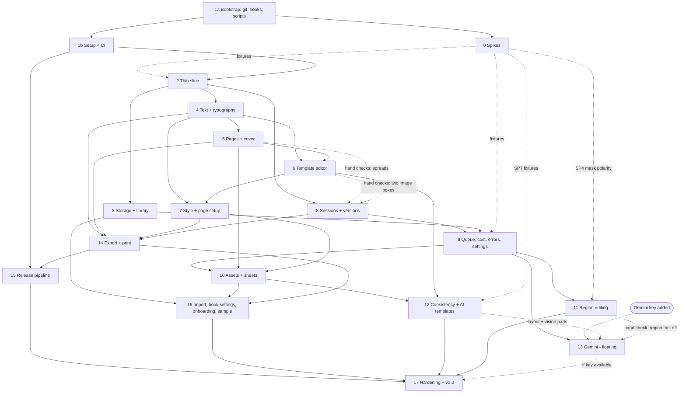

# BookBook — Implementation Plan

**Status:** Draft v1, for review
**Date:** 2026-11-07
**Inputs:** `product-description.md` v4 (cited as **PD §n**) and `architecture.md` v1.1 (cited as **A §n**). `architecture-notes.md` is background only.
**Next step:** carry out the plan, one phase at a time. This document sets the order of work. It does not change the design. Where the plan needed a design detail, it's flagged as a **plan decision** so you can overrule it.

---

## 0. Decisions recorded before planning (2026-11-07)

| Topic | Decision | Where it's recorded |
|---|---|---|
| A §15 product changes | Already applied to PD v3. Nothing outstanding. | PD header |
| A §16 decisions made without asking | All 8 accepted as written. | A §16 |
| Minimum OS | **macOS 27.** macOS 26 is no longer supported. | PD §3, A §2 |
| Toolchain | Xcode 27.x (Swift 6.4), locally and in CI. CI uses GitHub's `xcode-27` runner label (macOS 27, Apple Silicon). | A §2, D13, §13.2 |
| Repository | Public on GitHub at **`buckleypaul/bookbook`** (personal account), created 2026-11-07 with the planning docs as the first commit. Commits use the repo-local identity `Paul Buckley <paul@paulbuckley.me>`. The Homebrew tap will be `buckleypaul/homebrew-tap`. | A §13.2, §13.3 |
| Signing | A Developer ID Application certificate is available. | A §13.2 |
| Bundle ID | `app.bookbook.BookBook` (kept). | A §13.1 |
| Live-API spend cap | **$10 in total** for the spikes plus routine live tests during development. This doesn't cover content you make yourself in the app (see the content note in Phase 16). | §2.4 |

**Plan decisions** (made here; easy to overrule):

- **P-1: one local package.** All modules are library targets in a single local Swift package, `BookBookKit/`, rather than one package per module. The module boundaries in A §3 stay the same, and they're enforced by target dependencies. This keeps `swift test --filter LiveProviderTests` a single command run from one folder, and cuts the boilerplate.
- **P-2: the crash-safe journal comes in the first slice.** It's small, and adding it after other code already writes files would be riskier. Fault-injection tests come in Phase 3.
- **P-3: the command and undo layer comes in the first slice.** Every edit goes through `BookDocument.perform` from the start (A §6.3), so later phases never have to move mutations over to it.
- **P-4: `GenerationQueue` exists from the first slice**, as a serial in-memory actor. Persistence, reordering, retries and the queue window come in Phase 9. That way the slice's single generation already follows the real path.
- **P-5: OpenAI text and vision calls use Chat Completions with `store: false`**, not the Responses API. This keeps A §7.6's "no Responses API in v1" true for every OpenAI call. If SP-7 shows that structured output or vision only works through Responses for the chosen models, that's raised with you as an architecture change, not decided in the plan.
- **P-6: Phase 1 starts with a short bootstrap step (1a)**: `.gitignore`, the secret-scan pre-commit hook, `scripts/live-tests.sh` and `scripts/record-fixtures.sh`. Phase 0 depends on 1a, so the key-safety tooling exists before the first live call. The rest of Phase 1 (1b) runs alongside Phase 0.

---

## 1. Phase overview

Sizes: **S** is a few focused days, **M** about a week, **L** about two weeks (agent-assisted, with you reviewing). They're relative, not promises.

| # | Phase | Size | Ends with something you can use |
|---|---|---|---|
| 0 | Live-API spikes and fixtures | S | A spike report and recorded fixtures. The catalog and price list are seeded from real responses. |
| 1 | Project setup and CI | M | The app launches to an empty Library window. CI is green on `xcode-27`. |
| 2 | **Thin vertical slice** | L | Open a book, type text, generate an image with OpenAI, place it, export a PDF. |
| 3 | Storage and library | M | A library grid with thumbnails. Books survive crashes. Several book windows can be open. |
| 4 | Text and typography | M | Rich story text in real fonts, with spelling, overflow and text undo. |
| 5 | Pages tab, ordering and cover | L | A whole book's structure: spreads, reordering, story import, cover, page numbers. |
| 6 | Template editor | L | Your own layouts, made in a visual editor. |
| 7 | Style guide and page setup | M | Style tab, page sizes, bleed, and the style changed / layout changed flags. |
| 8 | Sessions and versions | L | A full chat, version strip and refinement workflow for each image box. |
| 9 | Queue, cost, errors and settings | L | A real queue, cost estimates and totals, plain-language errors, "Draft all empty boxes". |
| 10 | Assets and character sheets | L | Consistent characters: references, `@mentions`, sheets, where-used. |
| 11 | Region editing | M | Brush or lasso an area and change only that area (OpenAI). |
| 12 | Consistency check and AI templates | M | Drift warnings with a one-click fix. Describe a layout and get a template. |
| 13 | Gemini provider *(floating)* | L | A second provider, with "Retry with Gemini". |
| 14 | Export and print, complete | L | Print-shop PDF with bleed and crop marks, booklets, preflight, Print, PNG/JPEG export. |
| 15 | Release pipeline | M | `brew install --cask buckleypaul/tap/bookbook` installs a notarized build. |
| 16 | Library import, book settings, onboarding, sample | M | First-run setup, the new-book wizard, the sample book, clean-up, import from another book. |
| 17 | Hardening and v1.0 | M | Tagged v1.0.0, installed through the tap. |

**Milestones**

- **M1, the slice (end of Phase 2):** the end-to-end path works.
- **M2, write and draft a whole book (Phases 3–9):** your household can start using local builds for real books.
- **M3, consistent illustration (Phases 10–12):** characters stay the same from page to page.
- **M4, print-ready and installable (Phases 14–15):** printed copies, installed with brew.
- **M5, v1.0 (Phases 16–17).**

---

## 2. Working rules for every phase

### 2.1 Definition of done (applies to every phase)

1. CI is green: unit and snapshot tests, the app build, and the secret scan.
2. The phase's **hand acceptance checks** have been run by you on macOS 27, in a Debug build launched from Xcode, or from the release build once Phase 15 is done.
3. Every new edit that PD §8.10 says is undoable goes through a `BookCommand`, and its undo/redo has been checked by hand.
4. Anything new that's sent to a provider is visible in Version details. That's the privacy rule in A §11.
5. Any design change found while building is written back into `architecture.md` in the same change. Product-level changes go into `product-description.md`, after asking you.

### 2.2 API key hygiene (applies to everyone, including subagents)

The OpenAI dev key lives in the macOS Keychain (service `openai-api-key`, account `$USER`). A Gemini key will be added later as `gemini-api-key` in the same way.

- **The only allowed way to use it** is to inline it into the test process's environment:
  ```sh
  OPENAI_API_KEY="$(security find-generic-password -a "$USER" -s openai-api-key -w)" \
    BOOKBOOK_LIVE_TESTS=1 swift test --filter LiveProviderTests
  ```
  This is run from `BookBookKit/`. Only two scripts may use the key: `scripts/live-tests.sh [openai|gemini] [filter]` and `scripts/record-fixtures.sh` (which runs the same tests in record mode). Both use exactly this pattern, with no `set -x`, no `env` dumps and no echoing. To keep the key away from the compiler and build tools, they first run `swift build --build-tests` *without* the key, then run `swift test --skip-build --filter …` with the key inlined. Live tests never start child processes.
- **Remaining risk you accept:** while a live test runs, other processes running as your user can read its environment (e.g. `ps -E`). Runs are short, and nothing else gets the key.
- **Never** print, log, `echo`, write to a file, put in a fixture, commit, or paste the key into chat. Never run `security … -w` on its own, outside `$(…)`.
- Tests read the key only from `ProcessInfo.environment`. It's passed straight to the HTTP client and goes into nothing that can appear in a failure message.
- `BBNet` always redacts `Authorization` and `x-goog-api-key` in its own diagnostics. Request and response bodies are never logged (A §7.12).
- **The fixture recorder** saves only response bodies plus an allowlist of response headers (`content-type`, `retry-after`, rate-limit headers, `x-request-id`). Request headers are never saved. Before writing a file, it checks in memory that the file's bytes don't contain the key, and refuses to write if they do. Organisation and project IDs are replaced with placeholders.
- **Live tests never use snapshot assertions**, so nothing is written to `__Snapshots__` from a live run. The only files a live run writes are fixtures (through the recorder) and the spend log.
- **Secret scanning:** a pre-commit hook and a CI step (covering every tracked file, including `__Snapshots__` and fixtures) grep for `sk-[A-Za-z0-9_-]{20,}`, `sk-proj-…` and `AIza[0-9A-Za-z_-]{35}`. GitHub push protection is turned on (free for public repos).
- **Live tests never run in CI.** They skip themselves unless `BOOKBOOK_LIVE_TESTS=1` is set and a key is present.
- The in-app key, added in Phase 2, is separate. You paste it into the app's Settings, and the app stores it under its own Keychain item (`app.bookbook.api-key` / `openai`, A §5.5). The app never reads the dev item. The Settings field is a `SecureField`, and the key goes only into the Keychain: never into `UserDefaults`, `@SceneStorage` or `@AppStorage`, window restoration state, the queue file or logs. The field is cleared once the key is saved.

### 2.3 Live test structure

- `LiveProviderTests` sits in the `BBOpenAITests` and `BBGeminiTests` test targets, with one suite per provider. Test names start with the spike ID (e.g. `SP4_maskPolarity`) so they can be filtered one at a time.
- **`LiveSpendGuard`** writes the estimated cost of each live call, priced from reported `usage` with the bundled price list, to `~/Library/Caches/BookBook-dev/live-spend.jsonl`. The file holds no key or prompt text. Live tests skip, with a message, once the running total passes `BOOKBOOK_LIVE_BUDGET`, which defaults to **$10**. These are estimates, so check against the provider dashboards after Phase 0.
- Live tests use **Draft/low** quality and small sizes unless the question needs something else.

### 2.4 Live spend budget ($10 total)

| Use | Allotted |
|---|---|
| Phase 0 OpenAI spikes | $3 |
| Phase 0 Gemini spikes (once the key exists) | $2 |
| Phase-end live passes (Phases 2, 8, 9, 11, 12, 13, 17: about $0.30 each) | $2.50 |
| Re-runs and contingency | $2.50 |

### 2.5 Parallel work with subagents

- **Contracts first.** At the start of each phase, the main thread lands the public types and protocols that the phase's lanes share (e.g. `BookCommand` cases, `ImageRequest`, `QueueItem`). Lanes then build against them.
- **One git worktree per lane.** The main thread merges lanes and runs the hand checks.
- **File ownership** prevents conflicts. Two lanes never edit the same file at once. Known hot spots: `CanvasView` (Phases 4, 6, 7 and 11), `BookDocument` (every phase), and `ModelCatalog.json` / `PriceList.json` (Phases 0, 9 and 13). Changes to a hot spot are made by the main thread, or by one lane at a time.
- **Good lane splits:** model plus tests / UI / provider adapter / fixtures. Bad lane splits: two lanes inside the canvas at once.
- A repo `CLAUDE.md`, created in Phase 1, holds the key-hygiene rules (§2.2), the module map and the ownership rules, so every subagent starts from them.

### 2.6 Phase workflow and progress tracking

- **`PROGRESS.md`** at the repo root is the single record of where the build is. It has one row per phase (in the order 1a, 0, 1b, 2, 3 … 17), with a status, branch, PR, live spend and notes. Each phase session updates it.
- **Statuses:** `not started` → `in progress` → `awaiting hand checks` (code is done, CI is green, the PR is open) → `done` (you've confirmed the hand checks and the PR is merged). `blocked` and `skipped (floating)` are also allowed.
- **One phase per session.** The session works on a branch called `phase-<id>-<slug>`, with git worktrees for parallel lanes. It opens a PR to `main` and stops at `awaiting hand checks`. The **next** session starts by asking whether the previous phase's hand checks passed. If they did, it merges that PR (squash) and marks the phase `done` before starting the next one.
- **Which phase is next:** the first phase in `PROGRESS.md` order that isn't `done` and whose solid dependencies (§3) are all `done`. Phase 13 is skipped while no `gemini-api-key` Keychain item exists. To check, run `security find-generic-password -s gemini-api-key >/dev/null 2>&1`; this checks the item exists without reading the key.
- **Git identity** is set in the repo config (`Paul Buckley <paul@paulbuckley.me>`). Don't override it.

---

## 3. Dependencies and parallel lanes

Solid arrows mean "must be merged before this phase starts". Dashed arrows mean "work can start without it, but it's needed for the hand checks or for one part of the phase", and the label says which.



**Preflight items** (Phase 14) for the asset-changed and consistency flags are added by whichever lands later: Phase 14, or the phase that adds the flag (10 or 12).

**What can run at the same time**

| Window | In parallel |
|---|---|
| Start | **1a** first (an hour or so). Then **Phase 0** (spikes, in a standalone `Spikes/` package) alongside **1b** (project and CI). |
| After M1 (Phase 2) | Three lanes: **A** = Phase 3 (storage); **B** = Phase 4 → Phase 5 → Phase 6 → Phase 7 (canvas and text; one lane, because they share `CanvasView`); **C** = Phase 8 → Phase 9 (AI). Phase 8's build work starts at once, and its hand checks wait for Phases 5 and 6. Phase 9 needs Phase 3 merged. |
| After Phase 9 | Phase 10 (assets, once Phase 7 is in) ∥ Phase 11 (region editing) ∥ Phase 13 image part (Gemini, if the key exists) ∥ Phase 14 (export, once Phases 4, 5, 7 and 8 are done). |
| After Phases 10 and 14 | Phase 12 (consistency, AI templates) ∥ **Phase 15 (release)** ∥ Phase 16 (onboarding etc.) |
| End | Phase 17 |

Phase 15 only *needs* Phase 1 and a working app. It's placed after Phase 14 so the first brew install is a printable app, but it can start earlier as a side lane if you want brew installs for household testing sooner.

**Critical path:** 1 → 2 → 4 → 5 → 6 → 7 → 10 → 12 → 17. The AI lane (8 → 9) runs alongside it and must finish before Phase 10.

---

## 4. Phase 0 — Live-API spikes and fixtures (S)

**Goal:** answer the "verify during implementation" items in A §14 against the live APIs before code depends on them, and record fixtures for the offline tests.

**Depends on:** Phase 1a (P-6), so the pre-commit hook and both key scripts exist before any live call.

**Scope:** A §7.1 (catalog), §7.5 (sizes), §7.6 (adapters, masks, history), §7.7–7.8 (structured output, vision), §7.9 (cancel, timing), §7.10 (usage and cost), §7.11 (errors), §14. A throwaway `Spikes/` SwiftPM package, with a small `URLSession` client and the fixture recorder, including its in-memory key check (§2.2), from the first commit. The recorder and redaction code move into `BBNet`'s test support in Phase 2.

**Method:** each spike is a live test (`SPn_…`) run through `scripts/live-tests.sh`. Results go into `spikes/REPORT.md` (question, what was sent, the observed answer, and what changes in the architecture or catalog). Fixtures go into `Spikes/Fixtures/<provider>/<spike>/`. Image payloads are shrunk to a 64 px placeholder PNG, except for one real image per endpoint.

Costs are estimated from the A §7.10 price list (image output about $30 per 1M tokens: low 1024² ≈ $0.006, medium ≈ $0.013, high ≈ $0.053; about $0.006 per reference image in). SP-2 checks these prices.

### 4.1 OpenAI spikes (now)

| ID | Question | Method | Est. cost |
|---|---|---|---|
| SP-1 | Which catalog models does this key see? Is the organisation verified for GPT Image? | `GET /v1/models`; compare with the catalog seed (`gpt-image-2.5-sunburst`, `2.6-sunburst`/`-flare`, `gpt-image-2`, `gpt-6-luna`, `gpt-6.1-terra`). One tiny generation shows whether a 403 verification error comes back. Record the error body if it does. | $0.01 |
| SP-2 | Which **usage/cost fields** come back, and do they match the estimator? Are free sizes accepted? | `/images/generations` at low 1024×1024, low 1024×1536, low with a computed free size (e.g. 1232×816, multiples of 16), one medium and one high 1024². Record `usage` (input/output, text/image token details), latency and returned pixel size. Also try one size below `minPixels` and one above the 2560×1440 "experimental" line, and record the response. | $0.15 |
| SP-3 | How do `/images/edits` with a base image plus references behave? | Multipart `image[]` with a base and 3 references, low. Check: the order is respected (prompt says "image 1 is the base"); usage counts input images; the output keeps the base's size; `output_format: png`, `moderation: auto`, `n: 1` accepted. One request with 16 images to confirm the cap, and one with 17 to record the error. | $0.30 |
| SP-4 | **Mask polarity:** is the edit area the *transparent* or the *opaque* part of the mask? | Base: a synthetic 1024² image of four solid-colour quadrants. Mask A: top-left quadrant transparent, the rest opaque. Mask B: the inverse. Prompt: "Fill the editable area with bright magenta; leave everything else unchanged." Measure, in code, which quadrant changed. Also record the error for a mask whose size doesn't match the base, and how far the changed area spills past the mask edge (this sets the feather default in A §7.6). | $0.10 |
| SP-5 | What do **refusals** look like (shape, `moderation_details`, billing)? | At most **2** requests with a prompt that should clearly be blocked (graphic violence; nothing involving real people or minors), to record the `moderation_blocked` / `image_content_policy_violation` body. Plus free error cases: a bogus key (401), an unknown model (404), an invalid size (400), and an oversized image upload. Kept small because repeated policy hits can flag an account. | $0.02 |
| SP-6 | What happens when a request is **cancelled**, and how long do requests take? | Start a high 1024×1536 generation and cancel the `URLSessionTask` after 5 s. Write down the UTC time, then check the OpenAI usage dashboard the next day (by hand) for a charge in that minute, with no other activity on the key around it. Record typical durations for low, medium and high, which seed the catalog's `typicalDuration`. | $0.10 |
| SP-7 | Do **structured output** (template) and **vision** (consistency) work with the planned models and schema? | Through Chat Completions with `store: false` (P-5): send the `TemplateDraft` JSON Schema (A §7.7, strict-mode intersection) to `gpt-6-luna` and validate the result. Send one consistency request to `gpt-6.1-terra` with a reference and a mismatching image at low detail, and validate it against the A §7.8 output schema. Record usage, and the `refusal` content shape if there is one. If either fails on Chat Completions, stop and raise it with you (P-5). | $0.05 |

**Expected OpenAI total: about $0.75.** $3 is allotted to cover re-runs.

### 4.2 Gemini spikes (once you add a key as `gemini-api-key`)

These run at the start of Phase 13, or earlier if the key turns up sooner. Prices are from A §7.10 (Nano Banana 2.1: 1K $0.034, 2K $0.050, 4K $0.113).

| ID | Question | Method | Est. cost |
|---|---|---|---|
| SG-1 | Which models are visible to the key? Is the account paid (EEA/UK)? | `GET models` with `x-goog-api-key`, compared against the catalog. | $0 |
| SG-2 | Do `aspectRatio`, `imageSize` and `thinkingLevel` behave as expected, and what's in `usageMetadata`? | Three generations: 1K/minimal, 2K/medium, a non-square ratio. Record thinking-token counts. | $0.15 |
| SG-3 | Does `store: false` get accepted? | Same request with and without it. | $0.07 |
| SG-4 | **Thought signatures:** does native multi-turn work when signatures are echoed back, and what happens without them? | Three-turn refinement with signatures echoed exactly; then the same with signatures removed, to record `MISSING_THOUGHT_SIGNATURE`. | $0.25 |
| SG-5 | Is the **inline request limit** 20 MB or 100 MB? | Requests with about 18 MB and about 25 MB of inline references (generated noise PNGs), at 1K. | $0.15 |
| SG-6 | What do **blocks** look like? | At most 2 clearly blockable prompts; record `promptFeedback.blockReason` and `finishReason`. | $0.05 |
| SG-7 | Cancellation and timing | As in SP-6. | $0.12 |
| SG-8 | Do structured output and vision work with the shared schema? | `gemini-3.1-flash-lite` with `TemplateDraft` and the consistency schema. | $0.02 |

**Expected Gemini total: about $0.80.** $2 is allotted.

### 4.3 Local (no-cost) spikes

These remove risk from Phase 2 and run alongside the live spikes.

| ID | Question | Method |
|---|---|---|
| SL-1 | Does drawing `NSTextLayoutFragment`s into a `CGPDFContext` keep text real and selectable, embed font subsets, and match the on-screen layout exactly? | A small test that renders the same text box to a bitmap and a PDF, then parses the PDF with PDFKit to check the text and fonts. |
| SL-2 | Can a TextKit 2 `NSTextView` laid over a layer-backed canvas run continuous spelling and grammar checking with `allowsUndo = false`, without falling back to TextKit 1? | A throwaway AppKit window with the fallback-notification assertion turned on. |
| SL-3 | Does `WindowGroup(for: BookID.self)` bring an already-open book to the front, and restore windows at relaunch, on macOS 27? | A throwaway SwiftUI app. |

**Deliverables:** `spikes/REPORT.md`; fixtures; corrections to `architecture.md` (§7.6 mask polarity, §7.9 cancel billing, §14 rows marked resolved); first real values for `ModelCatalog.json` and `PriceList.json`.

**Acceptance (by hand):** read `REPORT.md`. Every A §14 row that a live API can answer has an answer or an explicit "couldn't determine, because…". The OpenAI dashboard spend matches the `LiveSpendGuard` total within about 20%. `git grep` for key patterns finds nothing.

**Tests added:** none yet in the product. The fixtures become the input for the Phase 2 and Phase 9 adapter tests.

**Risks:** the account isn't verified for GPT Image (SP-1 finds out on day one; verification can take time, so start it at once if needed). Refusal spikes could flag the account (capped at 2 requests). Cancellation billing may not be visible in the dashboard at all, in which case the product keeps assuming it's billed.

---

## 5. Phases 1–17

### Phase 1 — Project setup and CI (M)

**Goal:** a repo, app and package structure that every later phase builds into, with CI and key hygiene in place from the first commit.

**Scope:** A §2, §3, §12 (CI), §13.1. Modules: an empty skeleton of every target.

**1a, bootstrap (first, about an hour):** the repo already exists (`git init` and the remote were done on 2026-11-07). 1a adds the full `.gitignore` (DerivedData, `.build`, `*.p8`, `*.p12`, `.env*`), the pre-commit secret-scan hook plus `install-hooks.sh`, `scripts/live-tests.sh` and `scripts/record-fixtures.sh` (§2.2), and the repo `CLAUDE.md` with the key rules. Then Phase 0 can start.

**Deliverables (1b)**
- On `buckleypaul/bookbook`: branch protection on `main` (PR required, CI must pass). Check that secret scanning and push protection are on.
- `BookBook.xcodeproj`: a thin app target (`@main`, scenes stubbed per A §6.1), `.xcconfig` files for Debug and Release, deployment target **macOS 27.0**, Swift 6 language mode with strict concurrency, hardened runtime on, bundle ID `app.bookbook.BookBook`, and an Info.plist with the `app.bookbook.book` UTType and document type (A §5.1).
- `BookBookKit/Package.swift` (P-1) with targets `BBModel`, `BBStore`, `BBLayout`, `BBNet`, `BBAICore`, `BBAI`, `BBOpenAI`, `BBGemini`, `BBExport`, `BBUI`, each with a test target. The dependency graph is exactly A §3. Pinned `swift-collections`; `swift-snapshot-testing` for tests only.
- Bundled resource folders: `ModelCatalog.json`, `PriceList.json`, prompt templates, presets (placeholders for now).
- `scripts/test.sh`, alongside the 1a scripts.
- `.github/workflows/ci.yml` on `runs-on: xcode-27`: `swift test` in `BookBookKit` (live tests skip themselves), `xcodebuild build test` for the app, an unsigned Release build, and the secret scan.
- The repo `CLAUDE.md` extended with the module map and ownership rules (§2.5), and a `README.md` with build instructions.
- A test font bundled in the test resources, so snapshot tests don't depend on which system fonts are installed.

**Acceptance (by hand)**
- Clone fresh, open in Xcode 27, and run. The app launches to an empty "Library" window, and Settings opens with ⌘,.
- Push a branch and CI goes green. Push a commit containing a fake `sk-…` string on a scratch branch: the pre-commit hook blocks it, and CI or push protection would too.
- `scripts/live-tests.sh openai` with no tests yet: it runs, reports zero live tests, and prints nothing secret.

**Tests added:** one smoke test per target, so each one builds and links. A test that confirms live tests skip themselves when `BOOKBOOK_LIVE_TESTS` isn't set.

**Risks:** the `xcode-27` runner label or image contents change (check against GitHub's runner-images notes when writing the workflow). SwiftPM tests for AppKit-dependent targets on CI (`BBLayout`) may need a window server; fall back to `xcodebuild test` for those targets if so.

---

### Phase 2 — Thin vertical slice (L) · **M1**

**Goal:** open a book → type text on a page → generate one image with OpenAI → place it → export a PDF. Every layer exists in a thin form, on its real architecture.

**Scope**
- `BBModel`: `Book`, `StyleGuide` (visual description, page setup for a fixed Letter portrait, no bleed), `Template`/`Box` (one built-in "image on top, text below" preset), `Page`, `ImageSlot`, `ImagePlacement`, `Session`, `Message`, `Version`, `Provenance`, and a plain-paragraph `RichText`. (A §4.1–4.3)
- `BBStore`: the package layout (A §5.1), content-addressed images, the transaction journal (A §5.2, P-2), 1 s debounced autosave (A §5.3), and a minimal library: a folder scan plus create.
- `BBLayout`: `PageGeometry` (no bleed), `TextBoxLayout` on TextKit 2, and `PageRenderer` for `.screen` and `.pdf(trim)` (A §8.2–8.4).
- `BBNet`: `HTTPClient` protocol, the URLSession client (A §7.12), `FixtureHTTPClient`, and the recorder moved over from `Spikes/`.
- `BBAICore`/`BBAI`: `ImageProvider`, `ImageRequest`/`ImageResult`, a minimal `ContextAssembler` (role, style text, avoid, composition aspect, story text, request), aspect fitting for free-size models (A §7.5), a `ModelCatalog` loader, and the `GenerationQueue` v0 (P-4).
- `BBOpenAI`: `/images/generations` only, with basic error mapping (invalid key, refusal, transient).
- `BBUI` and the app: a Library window ("New Book", a list of books), a book window with a page list of N pages using the one template, `CanvasView` showing the page, an NSTextView overlay for the text box, a minimal session panel (prompt field, Generate, a spinner with elapsed time, the latest version shown), continuous spelling and grammar checking turned on in the text overlay (SL-2), a Settings tab for the OpenAI key (`SecureField`, Keychain only, A §5.5 and §2.2), **File ▸ Export PDF…** (Standard), the `BookCommand` layer with undo for `SetRichText` (not coalesced yet), `ChooseVersion` and add/delete page (P-3), and a minimal `BookWriter` for open books.

**Deliverables:** the slice described above, plus the `Provenance` record for each generation (the exact prompt sent, model, quality, size, and usage when reported). The ledger isn't built until Phase 9.

**Acceptance (by hand)**
1. Launch, choose New Book "Test", and it opens in its own window with page 1.
2. Click the text box and type two sentences. Misspellings are underlined. ⌘Z undoes the typing.
3. Settings ▸ API Keys: paste your OpenAI key and save it. (It's stored in the app's own Keychain item; check in Keychain Access that it's there and not in the book folder.)
4. Click the image box, type "a fox in a red scarf at a castle gate, watercolour", and press Generate. Within about 2 minutes the image fills the box, cropped to aspect-fill.
5. Export PDF. In Preview, the page shows the image and the text. The text is selectable, and Preview ▸ Inspector shows embedded fonts.
6. Quit, relaunch and reopen "Test": the text, image and placement are all still there. Open the package in Finder (Show Package Contents): `book.json`, `pages/`, `sessions/` and `images/<sha256>.png` are there. No key appears anywhere: `grep -r "sk-" Test.bookbook`, `defaults read app.bookbook.BookBook | grep sk-` and `grep -r "sk-" ~/Library/Saved\ Application\ State/app.bookbook.BookBook.savedState` all find nothing.
7. Turn off Wi-Fi and press Generate: you get a plain-language "Offline" error. Editing text still works.

**Tests added:** Codable round-trips for every type. Journal roll-forward and discard (basic). `PageGeometry`. A `TextBoxLayout` overflow test. A rendered-page snapshot (PNG). A PDF test: parse it, check the text is there and fonts are embedded. A `ContextAssembler` prompt snapshot. Aspect fitting for the OpenAI catalog entries. OpenAI adapter tests against the Phase 0 fixtures (success, refusal, 401). One live test, `LiveProviderTests.slice_generateLow` (about $0.01).

**Risks:** TextKit 2 overlay quirks (reduced by SL-2). The model types in `BBModel` will churn as later phases land; keep the schema at version 1 until Phase 3 and allow breaking changes until then.

---

### Phase 3 — Storage and library (M)

**Goal:** books are durable, browsable and manageable, like real documents.

**Scope:** A §5.1–5.3, §5.4 (except `BookImporter` and the sample book, which are Phase 16), §5.5, and §6.1 (several windows, `OpenBooks`). Headless `BookStore` opening is built here; `BookWriter` deliveries into closed books use it in Phase 9. PD §8.1 (except import from another book, which is Phase 16), §7 (book switcher).

**Deliverables**
- Fault-injected save tests at every step. `.lock` single-writer handling with a read-only offer.
- `Migrator` framework with a schema v1 fixture.
- Orphan image sweep (more than 24 h old, at open).
- `costs.jsonl` append and repair primitive (used from Phase 9).
- `LibraryIndex` with `FSEvents` and the cached index.
- Library grid with cover thumbnails and modified dates. Rename, duplicate, delete to Trash, Show in Finder.
- Library location setting, with an offer to move the books.
- One window per book (from SL-3). A sidebar book switcher. Several books open at once.
- Thumbnail and downsample cache in `~/Library/Caches/BookBook/<bookID>/`.

**Acceptance (by hand)**
- Make three books. Duplicate one, rename one, delete one: it appears in the Trash, and Put Back restores it to the library grid.
- Copy a `.bookbook` into the library folder in Finder: it appears in the grid without a relaunch.
- Type in a book and force-quit (Activity Monitor ▸ Force Quit) within a second of the edit. Reopen: you get either the state before the edit or after it, never a broken book.
- Open the same book twice (double-click it twice): one window comes to the front.
- Change the library location and accept moving the books: they all appear in the grid at the new path.

**Tests added:** fault injection (crash after each of the 5 save steps × 3 entity mixes), lock handling, migration from the v1 fixture, ledger truncated-line repair, LibraryIndex refresh, and delete going to the Trash.

**Risks:** FSEvents noise from the app's own saves (filter events during own writes). Lock files left behind by crashes (check whether the recorded PID is still alive).

---

### Phase 4 — Text and typography (M)

**Goal:** story text looks and behaves like real typesetting.

**Scope:** A §4.2 `RichText` in full, §6.3 (text undo coalescing), §8.3. PD §8.2 typography, §8.6 canvas text, rich text and spelling. Modules: `BBModel` (RichText), `BBLayout` (`RichTextBridge`, `TextBoxLayout`, fonts), `BBUI` (formatting controls, the text overlay).

**Deliverables**
- Bold, italic and underline. Per-run font, size and colour. Paragraph alignment. Checking that spelling and grammar (turned on in Phase 2) still work with rich text.
- A format bar and the Format menu, with the standard shortcuts.
- `RichTextBridge` resolving style-guide defaults, so runs without an override follow the style when it changes.
- Typography fields in the style guide (body and title font, size, colour, line spacing, alignment). A minimal Style tab form for them; the full tab is Phase 7.
- Font import into `fonts/` with `.process` registration, a `fsType` embedding check, and missing-font fallback with a warning.
- A red "+" overflow badge.
- Coalesced `SetRichText` undo (1 s pause, box switch, or formatting change).
- A debug assertion for TextKit 1 fallback.

**Acceptance (by hand)**
- Type a paragraph, make "BOOM!" 48 pt red bold in a different font, and export a PDF: it matches the screen, and the text is selectable.
- Change the style's body font: unformatted text changes, and "BOOM!" keeps its own font.
- Import a `.ttf`. Use it, export, then remove the font file from your system: the PDF still shows the font.
- Type until the text overflows: the badge appears. Type, pause, type again, then undo twice: the text comes back in two steps.
- Switch pages and come back: undo still works without a crash.

**Tests added:** RichText ↔ NSAttributedString round-trips (property-based over random runs). Snapshot tests: render the same box on screen and in a PDF, then compare. Font embedding: parse PDF font dictionaries. Overflow edge cases. Undo coalescing timing (with an injected clock).

**Risks:** the TextKit 2 overlay and the rendered layout drifting apart (one layout path, plus snapshot tests). Font licensing flags on some system fonts.

---

### Phase 5 — Pages tab, ordering and cover (L)

**Goal:** lay out a whole book: spreads in reading order, a cover, and story text brought in from a file.

**Scope:** A §8.1 `PageSequencer`, §4.4 status, §10 (cover row). PD §8.5 (except "Draft all", which is Phase 9), §8.7, §8.2 page numbers, §8.10 (page commands). Modules: `BBLayout` (sequencer, page numbers), `BBModel`, `BBUI` (overview). **Depends on Phase 4**, for RTF formatting in story import and the title font on the cover.

**Deliverables**
- Spread overview: the cover alone, then page 1 on the right, in facing pairs.
- Add, insert, duplicate, delete, and drag-and-drop reorder. A spread-split warning with the "insert blank page" variant.
- Choose or change a page's template, with text and images reassigned to the new boxes.
- All built-in single and spread presets from PD §8.4 (as data, in `TemplatePresets.json`).
- Status badges: empty, in progress, done.
- Page numbers: position, font, start, skip rules.
- Story-text import: paste, `.txt` or `.rtf`; split at blank lines or a marker; a preview; into a new or existing book; one undo step.
- The cover page with title and author `BoxRole`s bound to the book's title and author, plus a minimal Book Settings sheet for those two fields.
- Double-click to open the page editor.

**Acceptance (by hand)**
- Import a 12-paragraph story from an `.rtf` with `---` markers. The preview shows 12 pages, and choosing Import creates them. ⌘Z removes all 12 at once.
- Drag a spread-template page to an odd position: a warning appears with "Insert blank page", and choosing it keeps the spread intact.
- Change a page from "image on top" to "text left / image right": the text and image move into the new boxes.
- Set the title in Book Settings: the cover updates. Page numbers appear in the PDF, skipping the cover and the dedication page.

**Tests added:** `PageSequencer` cases (split detection, blank insertion, every reorder combination for n ≤ 8). Story splitting (blank lines, markers, CRLF, RTF formatting kept). Template reassignment mapping. Page-number skip rules. Status derivation.

**Risks:** drag-and-drop in SwiftUI grids over facing-page pairs (fall back to an AppKit collection view if SwiftUI fights it).

---

### Phase 6 — Template editor (L)

**Goal:** design your own page layouts visually.

**Scope:** A §4.2 `Template`/`Box`, §6.2 canvas editing mode, §8.2 rotation and radius. PD §8.4 (except AI generation, which is Phase 12). Modules: `BBUI` (`CanvasView` edit mode, the Layouts tab), `BBLayout` (hit-testing, snapping). **Depends on Phase 5**, for applying templates to pages and placing spreads.

**Deliverables**
- Layouts tab: the template list, duplicate, delete (blocked while in use, with where-used).
- Visual editor: add image and text boxes, drag, resize, rotate, corner radius, layer order, full-bleed edge toggles, snapping to margins, guides and other boxes, align and distribute.
- Text-box style overrides: size, alignment, colour, background panel.
- Preview with sample text and placeholder art. Fold shown on spreads.
- Every edit undoable, with each drag as one group.
- Editing a template updates the pages that use it live.

**Acceptance (by hand)**
- Make a spread with an image across both pages and a cream rounded text panel. Snap guides appear while dragging. Undo each step.
- Apply it to two pages: both update when you move the panel in the editor.
- Rotate an image box by 5°: the page canvas and the PDF both show it rotated, with the image clipped correctly.

**Tests added:** hit-testing with rotation (inverse transform), snapping maths, align and distribute, normalized-frame conversion for single and spread pages, and an undo group per drag.

**Risks:** `CanvasView` is shared with Phases 4, 7 and 11. Split it early into `CanvasView` plus per-mode controllers (`TextEditingController`, `LayoutEditingController`, `PlacementController`) so lanes don't collide.

---

### Phase 7 — Style guide and page setup (M)

**Goal:** set the book's look and print geometry, and see what is out of date after a change.

**Scope:** A §4.1 revisions, §4.4 flags, §8.2 bleed and safe area. PD §8.2 in full (presets without sample images; those come in Phase 16), §8.5 flags and **Mark as OK**. Modules: `BBModel`, `BBLayout`, `BBUI`.

**Deliverables**
- Style tab: preset picker (text-only presets), visual description, style reference images, negative guidance pre-filled.
- Page setup: every size preset and custom size, orientation, margins.
- Bleed on/off with an amount. Trim line and safe-area overlays in both editors.
- Page-setup change handling: frames are kept normalized and focal points re-clamped.
- `visualRevision` bumps. **Style changed** and **layout changed** flags on thumbnails. Mark as OK.
- Undo for every field edit.

**Acceptance (by hand)**
- Change Letter to 8×8 in: boxes keep their relative positions, and the images whose box shape changed show "layout changed". Mark one as OK and its flag clears.
- Edit the visual description: placed images show "style changed". Typography edits don't trigger it.
- Turn bleed on: full-bleed boxes grow into the bleed, and the trim and safe-area lines show in both editors.

**Tests added:** flag derivation tables (A §4.4), focal-point clamping across size changes, render-rect bleed expansion, and revision bump rules.

**Risks:** the edge cases in "crops are kept where possible" (cover them with snapshot tests on extreme aspect changes).

---

### Phase 8 — Sessions and versions (L)

**Goal:** the full per-box AI workflow: chat, versions, refinement, your own images.

**Scope:** A §4.3, §6.2 session panel, §7.3 (full assembly without assets: calm areas, fold, safe area, lineage), §7.5 (placement), §7.6 (lineage tree, stateless edit mode, OpenAI `/images/edits`). PD §8.6 (except region editing and asset parts). Modules: `BBAI`, `BBOpenAI`, `BBUI`. Build work starts after Phase 2. The hand checks need Phase 5 (spreads) and Phase 6 (a template with two image boxes).

**Deliverables**
- Session panel: the chat thread with "refined version N" tags, and pending messages.
- Version strip: choose, star, delete, export as an image file.
- Version details: prompt, references sent and left out, provider, model, quality, cost (filled in Phase 9), date. **Regenerate with same settings.**
- Refinement through `/images/edits` with the base image, using the lineage only (refining an old version keeps later ones).
- Reset session (keep or discard versions, with confirmation; not undoable).
- **Use your own image** by drag or file picker, with EXIF normalization and HEIC → PNG.
- Pan and zoom crop on the canvas (undoable).
- Calm-area, fold and safe-area composition guidance in prompts.
- Quality picker (Draft, Standard, High).
- An **Include story text** toggle for each request (on by default), recorded in provenance (PD §8.6, A §7.3).
- Separate sessions for each image box.

**Acceptance (by hand)**
- On a page with two image boxes, generate in each. The two chats and version strips are independent.
- Refine v1 three times (v2–v4), then select v1 and refine again. A new v5 appears, v2–v4 remain, and Version details for v5 shows only the v1 lineage in its prompt.
- Drag in a scanned drawing and refine it ("make the sky blue").
- Reset with "keep versions": the chat clears and the versions remain.
- Pan and zoom the crop, undo it, then export: the PDF crop matches the screen.
- On a spread whose image crosses the fold, the prompt in Details contains the fold instruction.

**Tests added:** lineage resolution (branching trees), prompt snapshots (single, spread, overlapping text box, bleed), stateless-mode condensation, edits adapter multipart encoding (snapshot of the encoded body without the key), import normalization, and epoch hiding. Phase-end live check: one refinement at low quality.

**Risks:** prompt quality for refinements (the prompt templates are resource files, so they can be tuned without code changes).

---

### Phase 9 — Queue, cost, errors and settings (L) · completes **M2**

**Goal:** you can draft a whole book safely: queued work, known costs, understandable failures.

**Scope:** A §7.1 (catalog availability, successors, custom model ID), §7.9 in full, §7.10, §7.11, §6.4 (closed-book deliveries), §5.5. PD §5 (queue, cancel, costs, budget, refusals, reference limits), §8.11 (image parts), §8.5 "Draft all empty boxes", §8.12 cost display and budget (minimal). Modules: `BBAI`, `BBOpenAI`, `BBStore` (ledger), `BBUI`. **Depends on Phase 3**, for the ledger primitive, headless `BookStore` and several open books.

**Deliverables**
- `GenerationQueue`: persistence (restored paused, with a banner), reorder, remove, cancel running (with a billing notice and an estimated ledger entry), automatic retry with backoff and `Retry-After`, a 300 s timeout, offline pause through `NWPathMonitor`.
- Queue window, plus a sidebar badge showing book, page, box, estimate and progress (elapsed time against typical duration).
- `CostEstimator` and `CostCalculator`, the ledger, the cost shown next to Generate, a confirmation threshold, and budget warnings.
- `PriceList` with a user override, an editor, its as-of date and "reset to built-in".
- `ProviderError` mapping from the Phase 0 fixtures. `RefusalAdvisor` rules (A §7.11) with **Details**. Failed items stay in the queue.
- Settings: API key **Test connection**, list-models availability, a prompt when a model has disappeared, default model and quality, threshold, custom model ID.
- **Draft all empty boxes**, with the total estimate first.
- Book running total, recent requests, and the optional **budget** field, added to the minimal Book Settings sheet from Phase 5. The full Book Settings cost view is Phase 16.
- Deliveries into closed books (`BookWriter`, headless).

**Acceptance (by hand)**
- In a 12-page book, choose Draft all empty boxes. It shows "12 requests, about $0.07" and asks for confirmation if that's above your threshold. While it runs, keep editing text in another book. Reorder two waiting items, and cancel the running one: the notice says it may be billed.
- Quit halfway through. Relaunch: the banner reads "Resume N queued requests" and the queue is paused. Resume it.
- Close the book while items are queued: they still land, and reopening shows them.
- Set a $0.05 budget: a warning appears before the next generation, and it still runs if you confirm.
- Change the key to garbage: you get "Your OpenAI key was rejected" with steps, and Details shows the raw body with no key in it.
- Book total equals the sum in Recent Requests, with actual-cost entries marked as such.

**Tests added:** queue state machine (enqueue, run, cancel, fail, retry, persist and restore, offline); estimator against the published calculator figures and SP-2 actuals; error mapping for every fixture; advisor rule ordering; CostPolicy thresholds; headless delivery into a closed book; ledger totals. Phase-end live pass: a two-item queue plus one cancel (about $0.10).

**Risks:** queue and book write races (all writes go through `BookStore` actors; tests with an injected slow provider). Estimator drift (calibrate with SP-2 data).

---

### Phase 10 — Assets and character sheets (L) · **M3** begins

**Goal:** characters, places and objects that stay consistent because their references travel with every request.

**Scope:** A §4.2 `Asset`/`ReferenceSlot`/`CharacterSheet`, §4.3 mention tokens, §4.4 asset changed and where-used, §7.3 step 1 (assets in play), §7.4 (the `ReferenceSelector` in full, with the synonym table), §11 (real-person photos). PD §8.3, §8.6 (asset checklist, `@mentions`, reference another image), §3 (photo notice). Modules: `BBModel`, `BBAI`, `BBUI`. **Depends on Phase 7**, for the thumbnail flag framework and Mark as OK.

**Deliverables**
- Assets tab: create and edit assets of each type, with name, description and tags. Reference slots with one primary. A session for each slot.
- Character sheet: turnaround views and expressions (including custom ones). Lock items. **Generate whole sheet** (batch, with the estimate first).
- `@mention` autocomplete stored as tokens (renaming updates prompts).
- Page asset checklist.
- "Reference another image" picker.
- `ReferenceSelector` tiers and caps, with the "Left out: …" report.
- Where-used list with links.
- Asset changed flag.
- Delete with a where-used confirmation, which turns mentions into plain text.
- Real-person photo question on import (EXIF default), with a notice for each provider on first send. Acknowledgements stored in `Book`.

**Acceptance (by hand)**
- Make "Pip" (a fox). Generate a primary reference, then Generate whole sheet (8 items): the estimate is shown first.
- On page 3, write "@Pip yawning by the fire". Version details lists Pip's primary reference plus the *sleepy* expression and three-quarter view, in that order.
- Rename Pip to "Pippa": the page 3 prompt shows "Pippa". Change Pippa's description: pages using her show "asset changed".
- Import a phone photo as a reference: the real-person question defaults to yes. On first generation, the notice appears with OpenAI's policy link and the advice about photos of children.
- Delete an asset that's in use: the confirmation lists where it's used, and afterwards its mentions are plain text.

**Tests added:** `ReferenceSelector` table tests (tiers, caps, budgets, synonyms, inflections), mention token rewriting, the usage index under edits, asset-changed derivation, sheet batch construction, and a prompt snapshot with a cast.

**Risks:** sheet quality depends on the models (the prompts are resource files, tuned during household use).

---

### Phase 11 — Region editing (M)

**Goal:** change only part of an image.

**Scope:** A §6.2 region editor, §7.6 region editing (mask polarity from SP-4, local compositing). PD §8.6 region editing. Modules: `BBUI` (overlay), `BBAI`/`BBOpenAI` (mask payload), Core Image compositing in `BBAI` or `BBExport` (plan decision: a small `ImageOps` helper in `BBAI`). **Depends on Phase 9**, for the model picker and catalog capabilities in Settings.

**Deliverables**
- Brush and lasso tools at the version's pixel size, with brush-size control, erase and invert.
- Mask PNG with the polarity found by SP-4.
- Local feathered composite (feather width from SP-4).
- A `.regionEdit` version, with the raw provider output kept for Details.
- The tool is disabled, with an explanation, for models without `supportsMask`.

**Acceptance (by hand)**
- Brush over Pip's scarf and ask for "make the scarf yellow". Only the scarf changes. Flip between the old and new versions: pixels outside the mask are identical.
- Lasso the sky and replace it. The edge is feathered with no hard seam.
- Switch the model to a Gemini entry in Settings (the catalog row is enough, even before Phase 13): the region tool is greyed out with an explanation.

**Tests added:** mask rasterisation (brush and lasso to a bitmap), polarity encoding, the composite leaving outside pixels unchanged (exact equality away from the feather band), and feather width. Phase-end live check: one masked edit.

**Risks:** large images make the overlay slow (draw the mask at screen resolution and rasterise at full size on commit).

---

### Phase 12 — Consistency check and AI templates (M) · completes **M3**

**Goal:** catch drift automatically and fix it in one click, and turn layout descriptions into templates.

**Scope:** A §7.7, §7.8. PD §8.9, §8.4 AI generation. Modules: `BBAI` (`VisionProvider`, `LayoutProvider`, `TemplateDraft` validation and normalization), `BBOpenAI`, `BBUI`.

**Deliverables**
- Consistency follow-up queue items that jump the queue and are included in the parent's estimate.
- Warning badge using the catalog thresholds, a difference list, dismiss, one-click fix (estimate first, `.consistencyFix`), on-demand check for any version, and the global switch in Settings.
- Consistency warning flag on thumbnails, plus its preflight item if Phase 14 has already merged.
- Settings: default provider and model for **templates** and for the **consistency check**. PD §8.11 lists these separately from images.
- AI template generation from a description, with presets as few-shot examples, normalization (clamp, snap, bleed edges, degenerate boxes), opening in the editor.
- Refusals go through the normal error path.

**Acceptance (by hand)**
- Generate a page with Pip, deliberately asking for "a blue scarf" (his reference is red). A warning badge appears with "scarf is blue; reference is red". One-click fix shows its estimate, then produces a version with a red scarf.
- Turn the switch off: estimates drop, and no follow-ups are queued.
- Describe "big picture across the top two-thirds, two lines of text at the bottom in a rounded cream box": a sensible template opens in the editor, snapped to the margins.

**Tests added:** schema validation and normalization (fuzzed bad drafts), badge thresholds, correction-prompt composition, queue jump ordering, and estimates including follow-ups. Adapter tests from the SP-7 fixtures. Phase-end live pass: one check and one template.

**Risks:** false positives in the vision check (thresholds are catalog data; keep warnings advisory).

---

### Phase 13 — Gemini provider (L, floating)

**Starts when** you add a Gemini key and Phase 9 is done. The adapter code can be written earlier against documented shapes, but merges only after SG-1 to SG-8. The **image** part needs only Phase 9. The **layout and vision** parts merge after Phase 12 (they implement its protocols), and the region-tool check needs Phase 11.

**Goal:** a second provider for image, layout and vision, plus cross-provider retry.

**Scope:** A §7.1 Gemini quality mapping, §7.5 fixed ratios, §7.6 native history (thought signatures, budgets, stateless fallback, `store: false`), §7.11 Gemini signals. PD §5 quality levels and retry elsewhere, §8.11 per-provider explanations, §8.13 Gemini requirements text. Modules: `BBGemini`, `BBAI`, `BBUI` (settings).

**Deliverables:** run the Phase 0 Gemini spikes first. Then: the Gemini adapter with all three capabilities; `x-goog-api-key` header only; inline data within the budget; native multi-turn when eligible, with an automatic retry once in stateless mode on `MISSING_THOUGHT_SIGNATURE`; "Retry with <other provider>" for every non-auth failure; Settings text explaining what each quality level means per provider; Gemini key entry and test connection.

**Acceptance (by hand)**
- Set Gemini as the default provider. Generate and refine three times: Details shows "native history". Switch the provider mid-lineage and refine: Details shows "stateless".
- Force a refusal on OpenAI (the SP-5 prompt): "Retry with Gemini" is offered, and the retried request's prompt is the same.
- Region editing is unavailable on Gemini, with an explanation.

**Tests added:** request encoding snapshots, history eligibility rules, signature echo exactness, ratio fitting, finish-reason and block-reason mapping, and cost from `usageMetadata` including thinking tokens. Live: a two-turn refinement.

**Risks:** inconsistent signature docs (always echo, fall back once). `store: false` being rejected (catalog flag).

---

### Phase 14 — Export and print, complete (L) · **M4** begins

**Goal:** print-ready output for home, booklets and print shops.

**Scope:** A §9 in full, §8.4 RenderOptions (bleed, marks, print), §10. PD §8.8. Modules: `BBExport`, `BBLayout`, `BBUI` (export sheet). **Depends on** Phases 4, 5, 7 and 8 (imported images for the softness check). Preflight items for the asset-changed and consistency flags are added here if Phases 10 and 12 have merged, or by those phases otherwise.

**Deliverables**
- `ExportImagePreparer`: crop, 300 DPI target, Core Image upscaling (`Upscaler` protocol), the softness warning, "Preview upscaled", and the cache.
- Print-shop output: bleed, crop marks, `TrimBox`/`BleedBox`. It requires bleed, and offers to turn it on.
- Booklet imposition on Letter, A4, Tabloid and A3: padding (reporting how many blanks were added), scale-to-fit with a notice, printing instructions, cover as the outer sheet or excluded (exported separately).
- Options: cover, page range, spreads as single pages or double-width pages.
- Preflight sheet with grouped issues linking to pages (empty boxes, overflow, spelling, soft images, flags, consistency, missing fonts), and Export anyway.
- **Print** through `PDFDocument.printOperation`.
- PNG/JPEG export for single pages.
- Export runs in the background with progress and cancel.

**Acceptance (by hand)**
- A 10-page book with a 5.5×8.5 in page size, exported as a Letter booklet: "2 blank pages added", plus instructions. Print it double-sided, fold and staple: the pages read in order.
- Print-shop PDF: Preview shows crop marks, and Acrobat (or `PDFKit` box inspection in a test) shows the TrimBox and BleedBox.
- Place a 512 px image across a full-page box: preflight lists it as "will look soft", and Preview upscaled shows it at 100%.
- ⌘P prints through the standard macOS dialog.

**Tests added:** booklet ordering for n = 4…32 (A §9.3 formula), PDF box attributes, mark geometry, upscaler thresholds, preflight issue detection per type, and snapshot tests of imposed sheets.

**Risks:** printer duplex differences (the instructions are text, so print a test sheet first). Memory use on large books (prepare images in a stream, one page at a time).

---

### Phase 15 — Release pipeline (M) · completes **M4**

**Goal:** a tag push produces a signed, notarized build that installs with brew.

**Scope:** A §13 in full (with the macOS 27 and `xcode-27` changes). Repos: this repo, plus a new public `buckleypaul/homebrew-tap`.

**Deliverables**
- `.github/workflows/release.yml` on `xcode-27`, triggered by `v*`: a temporary keychain with the Developer ID certificate from secrets; archive and export with hardened runtime; `ditto` zip; `notarytool submit --wait` with an App Store Connect API key (fetching the log on failure); staple; re-zip; `shasum`; create the GitHub Release with notes; bump the cask in the tap with a fine-grained PAT; delete the keychain (`if: always()`).
- `Casks/bookbook.rb` per A §13.3, with `depends_on macos:` using **the bare-symbol form for macOS 27** (look up the symbol in current Homebrew at this point), `livecheck`, and a zap list that leaves out `Library/`.
- A `RELEASING.md` runbook, including how to rotate secrets.
- `MARKETING_VERSION` from the tag, and the build number from the run number.
- A `brew audit --cask --strict` step in the tap's CI.

**Acceptance (by hand)**
- Push `v0.1.0`. CI publishes a release. Then `brew tap buckleypaul/tap && brew install --cask bookbook` installs it, and it opens with no Gatekeeper warning. `spctl -a -vv /Applications/BookBook.app` shows "Notarized Developer ID".
- Push `v0.1.1`. `brew upgrade --cask bookbook` updates it, and your books are untouched.
- `brew uninstall --zap --cask bookbook` leaves the library folder in place.

**Tests added:** a workflow dry-run job (build and sign with an ad-hoc identity on PRs; skip notarization) so release breakage shows up before a tag.

**Risks:** certificate and secrets setup (you'll need to add: the Developer ID .p12 and its password, the App Store Connect API key .p8 with key ID and issuer, the tap PAT, and the team ID). Notarization delays.

---

### Phase 16 — Library import, book settings, onboarding and sample (M)

**Goal:** the app is friendly to start with and manageable over time.

**Scope:** A §5.4 `BookImporter`, sample book, §10 (§8.12, §8.13 rows), `CleanUp`. PD §8.1 import, §8.12, §8.13, §8.2 preset sample images.

**Deliverables**
- Import from another book: assets, templates and/or the style guide as independent copies; deduplication by hash; a rename prompt for name clashes.
- Book Settings in full: title and author, cost breakdown by type, recent requests, budget, size on disk, **Clean up** (count, bytes freed, confirmation).
- First-run guided setup: what a key is, steps for each provider, paste and test, typical costs from the price list, OpenAI verification and Gemini requirements text. It can be skipped and reopened from Settings.
- New-book wizard: title and author, size, style preset, optional main character, then an offer to import story text.
- Style preset sample images and the **sample book**, made by you in the app (see the content note below) and bundled.

**Acceptance (by hand)**
- On a fresh macOS user account: first run shows guided setup. Skip it, open the sample book with no key, and explore it.
- Run the wizard with a main character, and import story text at the end.
- Import Pip and a template from another book: editing the copy doesn't change the original.
- Clean up a book with 30 unused unstarred versions: it reports the count and MB, and afterwards the size on disk drops by that amount.

**Tests added:** importer deduplication, name clashes and ID remapping. The CleanUp deletable set (never placed, starred, reference or sheet versions). Wizard output in the model.

**Content note (outside the $10 live-test cap):** making about 8 preset samples and a 6–8 page sample book at Standard quality is roughly 40–60 generations, about **$1–3** in the app at catalog prices. You do this yourself through the app's own cost display.

**Risks:** the sample book's file size inflating the app (keep its images at Standard and limit its size, e.g. under 15 MB).

---

### Phase 17 — Hardening and v1.0 (M) · **M5**

**Goal:** confidence for real household use.

**Deliverables**
- XCUITest smoke suite (A §12): open the sample, edit text, undo, export a PDF.
- Performance pass on a 40-page book with 150 versions (open time, scrolling the overview, export time).
- Accessibility basics: VoiceOver labels in the sidebar, panel and queue; keyboard navigation.
- Catalog and price-list refresh, with a live list-models check.
- Final live pass through every provider capability.
- Schema v1 frozen, with a migration fixture committed.
- README and user notes.
- Release `v1.0.0` through Phase 15.

**Acceptance (by hand):** make a complete 16-page book for your household from the wizard to a printed booklet, with no blocking bugs. The UI smoke suite is green in CI. `v1.0.0` installs through the tap.

**Risks:** scope creep from household feedback (log it, and triage into v1.x unless it blocks).

---

## 6. Coverage check: product sections to phases

| PD section | Phase(s) |
|---|---|
| §3 constraints (macOS 27, BYOK, local, privacy notice, distribution) | 1, 2, 10, 15 |
| §5 AI usage: quality, cost, budget, queue, cancel, refusals, reference limits | 2, 8, 9, 10, 12, 13 |
| §7 app structure (sidebar, switcher, queue indicator, windows) | 2, 3, 9 |
| §8.1 library, import | 3, 16 |
| §8.2 style tab | 4, 5 (page numbers), 7, 16 (preset samples) |
| §8.3 assets | 10 |
| §8.4 layouts | 5 (presets), 6, 12 (AI) |
| §8.5 pages | 5, 7 (flags), 9 (draft all) |
| §8.6 page editor and sessions | 2, 4, 8, 10, 11 |
| §8.7 cover | 5 |
| §8.8 export and print | 2, 14 |
| §8.9 consistency | 12 |
| §8.10 undo | 2 (layer), every phase |
| §8.11 settings | 2, 3, 9, 12, 13, 16 |
| §8.12 book settings | 5, 9, 16 |
| §8.13 first run, wizard, sample | 16 |

---

## 7. Deferred / not in v1

**From the product description (non-goals and §9 "Later")**

- DMG download and a "new version available" notice.
- Screen/share PDF (low resolution).
- Read mode.
- AI-written story text.
- Print-on-demand specs: KDP/Lulu, spines, wraparound and back covers.
- Cloud sync, collaboration and accounts.
- Providers other than OpenAI and Gemini.
- Windows, iPad and web.
- Languages other than English, non-Latin scripts and right-to-left text.

**From the architecture and this plan**

- macOS 26 support (dropped 2026-11-07).
- Submission to the official homebrew-cask repo (needs notability; personal tap only).
- App Sandbox and the Mac App Store.
- OpenAI Responses API, server-side conversation state, background mode and server-side cancel.
- Partial-image streaming, and progress beyond elapsed time.
- Region edits for Gemini (outline plus local composite).
- Gemini Files API.
- OpenAI `xhigh`/`max` quality levels (in the catalog, not exposed).
- A Core ML upscaler (the protocol is ready).
- AI-ranked reference selection.
- Copying session history when importing assets from another book.
- Telemetry, crash reporting and update checks of any kind.

---

## 8. Open items to settle later (not blocking Phase 0 or 1)

| Item | Needed by |
|---|---|
| Apple team ID and the release secrets listed in Phase 15 | Phase 15 |
| When the Gemini key arrives | Phase 13 start |
| Homebrew `depends_on macos:` symbol for macOS 27 | Phase 15 |
| Whether to bring Phase 15 forward for household brew installs | After M2 |
